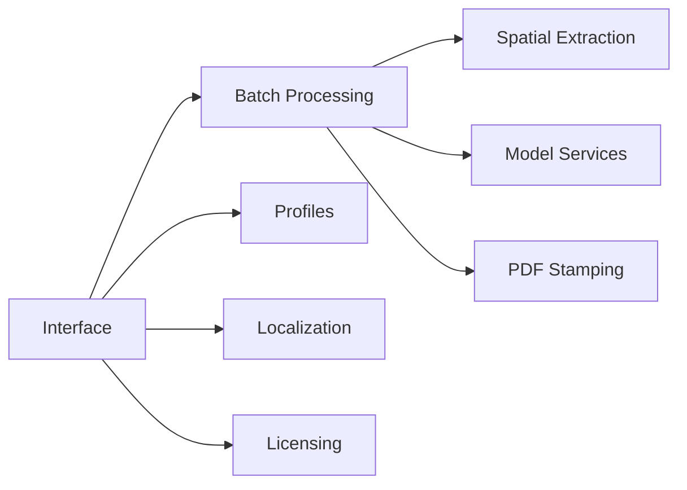

# docmapper — Technical Documentation

Entry point to the architecture of docmapper. This index is maintained with the
`architecture-docs` skill: the sections between `architecture-docs` markers are
generated by `build_index.py`; the rest is written by hand.

## System Overview

DocMapper extracts fields from documents with a recurring layout and writes them into destination documents. Today it is a browser application: a Vue 3 interface, services in TypeScript, pdf.js for reading, pdf-lib for stamping, optional Gemini calls, and an Express license backend. State lives in the browser's localStorage.

The product is being migrated to a Tauri desktop application with a hexagonal Rust core (ADR-0001, ADR-0002), module by module with the current TypeScript as parity oracle (ADR-0003). The desktop shell already runs the same interface in a desktop window, and the parity harness proves each module before it moves. The pages below describe the system as it works today and are updated as each module moves.

## Subsystems

<!-- architecture-docs:subsystems:start -->
| Subsystem | Summary |
|---|---|
| [Batch Processing](docs/architecture/batch.md) | Runs a profile over a whole file: splits documents, extracts, gates, falls back, stamps and names outputs. |
| [Desktop Shell](docs/architecture/desktop-shell.md) | Cargo workspace and the Tauri 2 shell: composition root of the desktop surface, its commands, permissions and how it loads the interface. |
| [Interface](docs/architecture/interface.md) | Vue 3 screens: editor, Mapping Studio, field list, destination placement, profile management. |
| [Licensing](docs/architecture/licensing.md) | Online license key and domain check against the Express and SQLite backend. |
| [Localization](docs/architecture/localization.md) | Interface dictionaries, machine translation through Google Translate and a local cache. |
| [Model Services](docs/architecture/model-services.md) | Calls to the Gemini API for validation pattern suggestions and vision fallback extraction. |
| [Parity Harness](docs/architecture/parity.md) | Fixtures, fixture writer, TypeScript oracle, Rust runner and id checker that prove each ported module gives the same outputs as the TypeScript code. |
| [PDF Stamping](docs/architecture/stamping.md) | Writes values, Code128 barcodes and QR codes onto destination PDFs and the shipment template. |
| [Profiles](docs/architecture/profiles.md) | Mapping profiles: the profile store, .dmap import and export, the typed model and the profile repository (browser storage today, SQLite in the core). |
| [Spatial Extraction](docs/architecture/extraction.md) | Reads glyphs with pdf.js and resolves mapped fields with the LSIE engine. |
| [Text Utilities](docs/architecture/text-utilities.md) | ECMAScript-exact Rust twins of the file name, validation pattern and dictionary helpers. |
<!-- architecture-docs:subsystems:end -->

## Architecture Decision Records

<!-- architecture-docs:adrs:start -->
| ADR | Title | Status | Version | Date |
|---|---|---|---|---|
| [ADR-0012](docs/adr/0012-malformed-profile-files-compared-by-error-kind-json-outside.md) | Malformed profile files compared by error kind; JSON outside Rust strings and f64 refused | accepted |  | 2026-11-09 |
| [ADR-0011](docs/adr/0011-unused-assemblyscript-cmr-core-removed-instead-of-ported.md) | Unused AssemblyScript CMR core removed instead of ported | accepted |  | 2026-11-09 |
| [ADR-0010](docs/adr/0010-validation-pattern-errors-compared-by-presence-not-by-messag.md) | Validation pattern errors compared by presence, not by message | accepted |  | 2026-11-09 |
| [ADR-0009](docs/adr/0009-pdf-reading-with-pdfium-and-a-fixed-glyph-tolerance.md) | PDF reading with pdfium and a fixed glyph tolerance | accepted |  | 2026-11-08 |
| [ADR-0008](docs/adr/0008-secrets-in-the-operating-system-keychain.md) | Secrets in the operating system keychain | accepted |  | 2026-11-08 |
| [ADR-0007](docs/adr/0007-licensing-and-policy-enforcement-through-the-levix-platform.md) | Licensing and policy enforcement through the levix-platform crates | accepted |  | 2026-11-08 |
| [ADR-0006](docs/adr/0006-profiles-stored-in-a-database-local-sqlite-by-default-centra.md) | Profiles stored in a database: local SQLite by default, central database by connection string | accepted |  | 2026-11-08 |
| [ADR-0005](docs/adr/0005-deterministic-extraction-first-vision-fallback-through-a-gen.md) | Deterministic extraction first, vision fallback through a generic model connector | accepted |  | 2026-11-08 |
| [ADR-0004](docs/adr/0004-lsie-from-the-shared-levix-platform-crate.md) | LSIE from the shared levix-platform crate | accepted |  | 2026-11-08 |
| [ADR-0003](docs/adr/0003-module-by-module-migration-with-the-typescript-code-as-parit.md) | Module-by-module migration with the TypeScript code as parity oracle | accepted |  | 2026-11-08 |
| [ADR-0002](docs/adr/0002-hexagonal-architecture.md) | Hexagonal architecture | accepted |  | 2026-11-08 |
| [ADR-0001](docs/adr/0001-tauri-desktop-app-with-a-rust-core-toward-a-100-rust-product.md) | Tauri desktop app with a Rust core, toward a 100% Rust product | accepted |  | 2026-11-08 |
<!-- architecture-docs:adrs:end -->

## How to Update This Documentation

- **A subsystem changed** (behavior, structure, data): edit its page in `docs/architecture/` in place, replacing outdated text.
- **A decision with alternatives and trade-offs**: create an ADR with `new_adr.py` and link it from the subsystem page.
- **A decision that reverses or corrects another**: create a new ADR with `--supersedes` or `--amends`; never rewrite an accepted ADR.
- **A feature was removed**: remove it from the subsystem page; its ADRs stay as history.
- **A release**: nothing here; release notes live in the GitHub releases.
- Run `check_docs.py` before committing.
