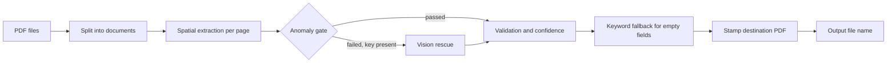

# Batch Processing

Runs a profile over a whole file: splits documents, extracts, gates, falls back, stamps and names outputs.

## Responsibilities

Owns running a mapping profile over a list of PDF files and producing one result per document: extracted values, per-field confidence, overall confidence, a stamped output PDF and its file name. It does not own the extraction geometry (Spatial Extraction), the stamping layout (PDF Stamping) or profile storage (Profiles).

## Structure

- `frontend/src/services/mapping/mapping-runner.ts`: `executeBatchMapping(options)` with `BatchProcessingOptions` (files, profile, progress callback).
- `frontend/src/services/mapping/filename-formatter.ts`: `formatOutputFileName`, which builds the output name from tokens such as `{originalName}`, `{seq:001}`, `{date}` and field values. Its Rust twin, with the validation pattern check, is in [Text Utilities](text-utilities.md), wired in when batch processing moves to Rust (M6).

## Behavior

- The number of pages per document is the highest `valueBox.page` in the profile; a one-page profile treats every page of the file as its own document.
- Fields are grouped by target page and extracted with `extractFieldsWithCalibration`.
- When a required field is missing or a topological anomaly is detected, and a Gemini key is stored, the page is sent to the vision fallback (Model Services); its values replace empty ones. Failures are logged as warnings and processing continues.
- A field still empty after that goes through a keyword fallback over the page text (shipment, seal, trailer, consignment, or the field's validation pattern).
- Confidence per field: 100 when extracted and matching its pattern (or with no pattern), 90 when it does not match the pattern, 0 when required and empty, 100 when optional and empty. The document confidence is the rounded mean.
- The destination PDF is stamped from the profile's template and destination mappings; a stamping error leaves the result without a PDF.

## Interfaces

- Called by the Mapping Studio and the editor (Interface).
- Calls Spatial Extraction, Model Services, PDF Stamping and the file name formatter.

## Decisions

- [ADR-0003](../adr/0003-module-by-module-migration-with-the-typescript-code-as-parit.md): ported in module M6 with fixtures and recorded model responses.
- [ADR-0005](../adr/0005-deterministic-extraction-first-vision-fallback-through-a-gen.md): the vision rescue moves behind a generic model connector.
