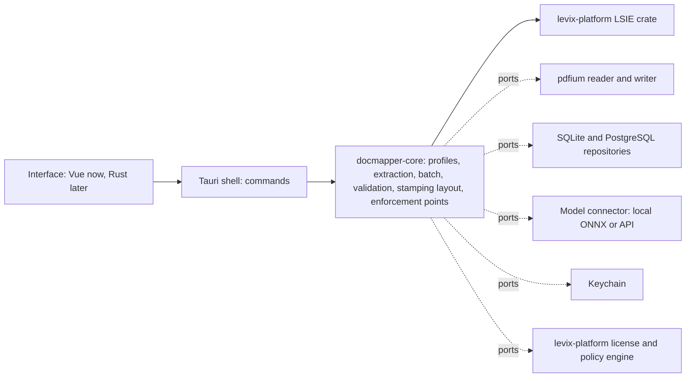

# DocMapper: Technical Specification

DocMapper is an on-premise desktop application: a Tauri shell with a hexagonal Rust core (`architecture.style: hexagonal` in `.dev-cycle.json`), adapters for every external system, and, during the migration, the existing Vue interface. The target is a 100% Rust product with no Node.js or other runtime dependency. How each part works is described in [TECDOC.md](../../TECDOC.md); this document holds the product-wide technical decisions and requirements.

## Platforms and Stack

- **Platforms**: Windows 10 and later (x64), macOS 12 and later (Apple silicon and Intel), Linux x64 (Ubuntu 22.04 and later). The Personal and Pro editions are installed per user; the Business edition adds a server surface hosted by the customer ([ADR-0014](../adr/0014-editions-personal-and-pro-on-the-desktop-business-served-from.md)).
- **Core**: Rust (stable, edition 2021), Cargo workspace in this repository ([ADR-0001](../adr/0001-tauri-desktop-app-with-a-rust-core-toward-a-100-rust-product.md), [ADR-0002](../adr/0002-hexagonal-architecture.md)).
- **Desktop shell**: Tauri 2, exposing core use cases as commands.
- **Interface during the migration**: Vue 3 (Composition API), TypeScript and Tailwind CSS, built with Vite; replaced by a Rust interface in a later epic, which removes Node.js from the product.
- **Extraction**: the shared LSIE crate from levix-platform, consumed by git tag ([ADR-0004](../adr/0004-lsie-from-the-shared-levix-platform-crate.md)).
- **PDF reading**: pdfium through `pdfium-render` ([ADR-0009](../adr/0009-pdf-reading-with-pdfium-and-a-fixed-glyph-tolerance.md)).
- **Storage**: SQLite (`rusqlite`) on the desktop; PostgreSQL as the shared base of the Business server ([ADR-0006](../adr/0006-profiles-stored-in-a-database-local-sqlite-by-default-centra.md)).
- **Vision fallback**: a generic model connector over HTTP (`reqwest`) and, by default, local ONNX models (PP-OCRv5 for text, LiLT for key-value extraction) run through the shared levix-platform ONNX crate ([ADR-0005](../adr/0005-deterministic-extraction-first-vision-fallback-through-a-gen.md)).
- **Secrets**: the operating system keychain through `keyring` ([ADR-0008](../adr/0008-secrets-in-the-operating-system-keychain.md)).
- **Licensing and policy enforcement**: the levix-platform license crate and policy engine ([ADR-0007](../adr/0007-licensing-and-policy-enforcement-through-the-levix-platform.md)).
- **JavaScript semantics needed for parity**: `regress` (ECMAScript regular expressions), `ryu-js` (number formatting), `indexmap` (key order).
- **Tests**: Vitest for TypeScript characterization tests, `cargo test` with `proptest` for Rust, a shared fixture format in `parity/` ([ADR-0003](../adr/0003-module-by-module-migration-with-the-typescript-code-as-parit.md)).

## Architecture Overview

The core owns the rules and the ports; adapters implement the ports in separate crates; the shell wires them together. The core never imports a framework or driver (`forbidden_core_imports`, checked by `check_design`). Details per subsystem are in [TECDOC.md](../../TECDOC.md).

## Non-Functional Requirements

### Performance

- Extraction of one document, including PDF reading, under 1 second on a computer with 4 CPU cores and 8 GB of RAM; LSIE resolution alone under 10 ms per page.
- A batch of 100 one-page documents processed in under 60 seconds on the same computer, without the vision fallback.
- Application start to a usable screen in under 3 seconds.
- Local vision fallback under 5 seconds per page on CPU.

### Security and Privacy

- Documents and extracted data are processed only on the user's computer and stored only in the customer's database (local SQLite or the central database the customer configures). Levix never receives documents or extracted values.
- No network call happens unless the user or the policy enables it: a model API endpoint, a central database or the Admin Hub. Each call is listed in the product manifest.
- Secrets (model API keys, connection strings) live only in the operating system keychain; never in the database, logs or `.docmapper` files.
- The license is verified offline against the Levix signature; policies are accepted only when signed by the Admin Hub key pinned at enrollment.
- Telemetry, when the Admin Hub is used, carries counts only, never content.
- Personal data in documents is under the customer's control, which supports GDPR and LGPD obligations.

### Availability and Recovery

- The application works fully offline, except for the features the user points to the network.
- Corporate environment: the last valid policy and certificate apply for the validity the company sets (default 72 hours); after that only the corporate environment is suspended.
- Local SQLite is written in WAL mode; profiles can always be exported to `.docmapper` files as a backup. Backup of a central database is the customer's responsibility.

### Accessibility and Localization

- Interface text in every language the product offers, with English as the source; extraction and stamping handle any Unicode text in documents.
- Keyboard access to every action and a minimum contrast ratio of 4.5:1 for text (WCAG 2.1 AA as the target).

## Integrations

- **levix-platform crates** (LSIE, license, policy engine, verified catalog): consumed by git tag; a build dependency, never a runtime call to Levix.
- **Levix Admin Hub** (optional, required for paid use above five machines): delivers license, policies, seats and model endpoint over the Admin Hub channel; when unavailable, the offline validity applies.
- **Model APIs** (optional): any endpoint configured by the user or the policy; when unavailable, the result keeps the deterministic values and is marked for review.
- **Central database** (optional): PostgreSQL through a connection string; when unavailable, the application reports it and does not fall back silently to the local database.
- **Data export**: CSV, JSON and XML files with a configurable schema; ERP connectors are added through the roadmap.
- **MCP server**: a second surface of the core (`crates/docmapper-mcp`, stdio transport) exposing profiles, extraction and results to any MCP client on the same computer, under the same license and policy checks as the desktop app.

## Data

- **Profile**: name, field definitions (label box, value box, page, data type, validation pattern, required flag), destination template and destination mappings, output name pattern. Stored as JSON in the database; `.docmapper` files use the same JSON.
- **Extraction result**: values and confidence per field, overall confidence, status; produced per batch and exported by the user, not stored by default.
- **Settings**: per installation in the local database; secrets in the keychain.
- **Migrations**: schema changes are additive and backward compatible; every release can open the database of the previous release. Data from the browser version (localStorage) is imported through `.docmapper` export and import.

## Constraints

- **Parity**: no behavior changes during the migration; each module switches only when its fixtures, fuzzing and shadow mode pass ([ADR-0003](../adr/0003-module-by-module-migration-with-the-typescript-code-as-parit.md)).
- **On-premise**: no Levix-hosted service in the processing path.
- **Final target 100% Rust**: no new Node.js or other runtime dependency in the product; the Vue interface and the parity oracle are the only temporary exceptions.
- **Shared code**: LSIE, licensing and policy code live in levix-platform; changes there are generic, go through pull requests, and must not break other products.
- **Third-party model licenses**: every default local model must allow commercial use and redistribution; licenses are checked per checkpoint before a model enters the catalog.
- **Development setup**: Rust toolchain and Node.js (until the Rust interface epic); no Docker and no server.

## Open Questions

None.
